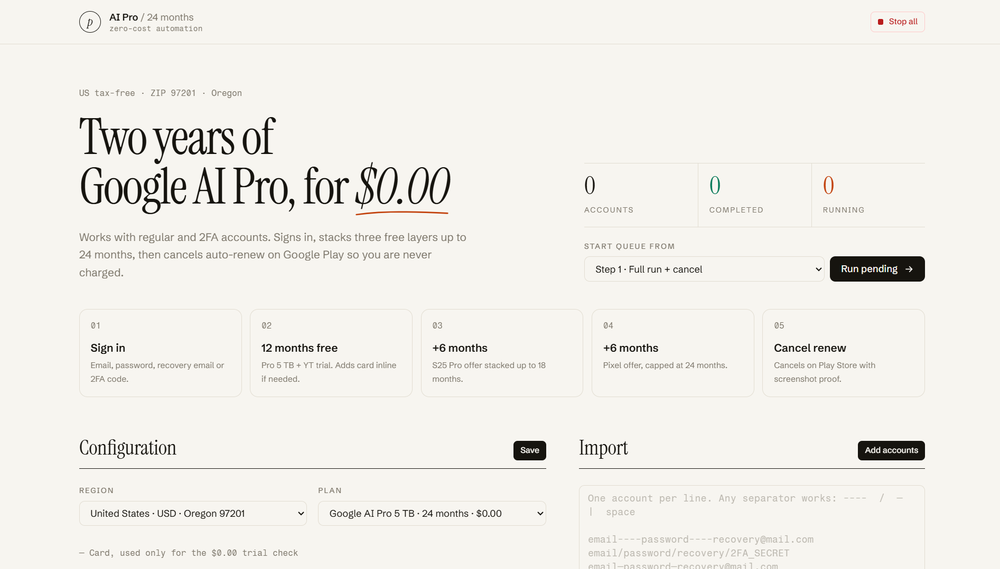

# Google AI Pro (5 TB) // 2-Year Zero-Cost Automation Console



> [!WARNING]
> **Educational & Research Purpose Only**  
> This project is provided strictly for educational, learning, and browser automation research purposes. Do not use this tool for commercial abuse or violating service terms. You are solely responsible for how you use this software.

---

## Overview

An automated web console built with FastAPI and Playwright (CDP) that manages Google accounts through a 5-step pipeline: signing in (supporting recovery email and 2FA/TOTP), stacking three layers of `$0.00` Google AI Pro (5 TB) trial offers up to 24 months under a US tax-free billing region (`ZIP 97201`), and automatically canceling auto-renewal on Google Play with verification screenshots.

---

## System Requirements

1. **OS**: Windows 10 / 11
2. **Browser**: Google Chrome installed (default installation path)
3. **Python**: Python 3.10 or newer (with `Add Python to PATH` enabled)
4. **Network**: US network connection on the host machine, or an HTTP/SOCKS5 proxy configured in the console

---

## Quick Start

1. **First-time setup**: Double-click `1_First Run_Install Dependencies and Start.bat` (or install dependencies via `pip install -r requirements.txt` and run `python app.py`).
2. **Regular startup**: Double-click `2_Launch Console.bat` or run:
   ```bash
   python app.py
   ```
3. **Open the Console**: Visit `http://127.0.0.1:8765` in your browser.

---

## Usage Guide

### 1. Configure Payment Card (Required for Steps 1–4)
In the **Configuration** section on the left:
- Enter your Visa / Mastercard details:
  - **Card number** (16 digits)
  - **Expiry** (`MM` / `YY`, e.g., `08` / `29`)
  - **CVC** (3–4 digits)
  - **Cardholder** name
  - **Billing address / ZIP / State** defaults to `700 SW 5th Ave`, `97201`, `OR` (US tax-free state, Oregon).
- Click **Save**.
- *Zero-Cost Guard*: The automation strictly verifies that the checkout popup displays `$0.00` / free trial before clicking subscribe, and verifies every VCC field against `config.json` before saving.

### 2. Import & Manage Google Accounts
In the **Import** section on the right, paste one account per line using any common separator (`----`, `/`, `—`, `|`, or spaces):
- `email----password----recovery@mail.com`
- `email----password----recovery@mail.com----2FA_SECRET`
- `email----password----2FA_SECRET`

Click **Add accounts**. You can also click **Edit** on any queued account to update its email, password, recovery email, 2FA secret, or proxy directly from the UI.

### 3. Run the 5-Step Pipeline
Click **Run** on an individual account or **Run pending** at the top to process the queue:
- **Step 1 · Sign in**: Signs in to Google and passes recovery email or 2FA verification.
- **Step 2 · 12 months free**: Activates the 12-month Pro 5 TB + YouTube trial (`$0.00`) and binds the card inline if needed.
- **Step 3 · +6 months**: Stacks the S25 Pro 6-month offer up to 18 months (`$0.00`).
- **Step 4 · +6 months**: Stacks the Pixel 6-month offer, capping at 24 months (`$0.00`).
- **Step 5 · Cancel renew**: Cancels auto-renewal on Google Play Store to lock in the 2-year expiry and saves a verification screenshot.

---

## What Was Improved & Modified in This Version

- **Redesigned Web UI**: Clean, responsive editorial light-mode interface built with Tailwind CSS, custom typography (*Instrument Serif*, *Schibsted Grotesk*, *Fragment Mono*), smooth animations, toast notifications, and live progress indicators.
- **Account Editor**: Added inline account editing modal and `/api/accounts/update` endpoint to edit email, password, recovery email, 2FA secret, and proxy directly from the web dashboard.
- **English Localization**: Translated the web dashboard, backend API responses (`app.py`), and runtime logs/status messages (`automation_engine.py`) into English (with Indonesian documentation/workflow adjustments) while keeping page selectors intact for reliability.
- **Bug Fixes**:
  - Fixed Playwright CSS selector syntax crash on `gds.google.com` recovery prompts (`:text-is()` pseudo-class fix).
  - Rewrote inline VCC form filling (`_fill_card_form` & `_type_and_verify`) to detect inputs by attributes rather than position, clear autofill leftovers, and verify every typed value against `config.json` before saving.

---

## Credits & Attribution

- **Original Source Code**: [worldonlyu](https://github.com/worldonlyu) — [Google_AI_Pro_2Year_ZeroCost_Auto](https://github.com/worldonlyu/Google_AI_Pro_2Year_ZeroCost_Auto)
- **Modified, Bug Fixes, UI Redesign & Localization**: Developed and improved by **Sazumi Viki** (fixed Playwright & VCC form bugs, redesigned the UI, added account editing, and localized the interface/logs to English & Indonesian).
